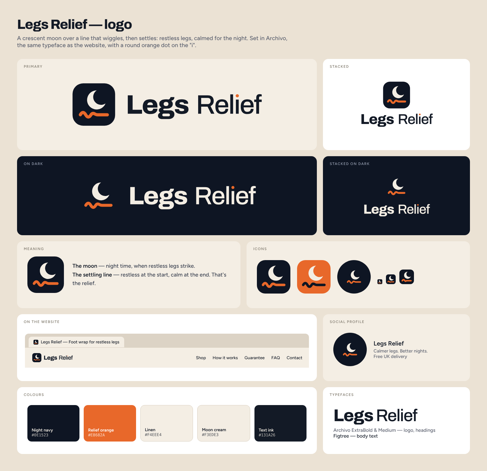

# Legs Relief — logo files

**The idea:** a crescent moon over a line that wiggles, then settles: restless legs, calmed for
the night. The name is set in Archivo (the website's heading font): **Legs** in ExtraBold,
**Relief** in Medium, with a round orange dot on the "i".

SVG files scale to any size (use them for print and packaging). PNG files have transparent
backgrounds unless noted. All lettering is converted to shapes, so nothing depends on fonts.

## Which file goes where

| Use | File |
|---|---|
| Website header and footer, browser tab icon | Built into the theme. Nothing to upload. |
| Shopify *Settings › Brand › Logo* (checkout, emails, Shop app) | `png/logo-horizontal.png` |
| Shopify *Settings › Brand › Square logo* | `png/icon-512.png` |
| Shopify *Settings › Brand › Cover image* | `png/social-cover-1920x1080.png` |
| Favicon (if you upload one in *Theme settings › Layout*) | `png/favicon-512.png` |
| Instagram, Facebook, TikTok profile picture | `png/social-avatar-1080.png` (safe for round crops) |
| Facebook / YouTube cover, slides | `png/social-cover-1920x1080.png` |
| On dark photos or dark backgrounds | `png/logo-horizontal-white.png`, `png/logo-stacked-white.png` |
| Square spaces (packaging front, stickers) | `svg/logo-stacked.svg` |
| App icon, phone home screen | `png/icon-1024.png`, `png/apple-touch-icon-180.png` |
| Name only (tight spaces, invoices) | `svg/wordmark.svg`, `svg/wordmark-white.svg` |

## Colours

| Name | Hex | Use |
|---|---|---|
| Night navy | `#0E1523` | Icon tile, dark backgrounds |
| Relief orange | `#E8682A` | The settling line, the "i" dot, buttons |
| Linen | `#F4EEE4` | Light backgrounds |
| Moon cream | `#F3EDE3` | The moon, text on dark |
| Text ink | `#131A26` | Logo text on light backgrounds |

For *Settings › Brand › Colours* in Shopify: primary `#0E1523` (contrasting `#F3EDE3`),
secondary `#E8682A` (contrasting `#FFFFFF`).

## Using the logo

- **Clear space:** keep empty space around the logo at least as wide as the moon.
- **Minimum size:** horizontal logo 100 px wide on screen (25 mm in print); icon 16 px.
- **Don't** stretch it, change the colours, add shadows or outlines, or rotate it.
- On photos, use the white version over a dark, calm area of the image.
